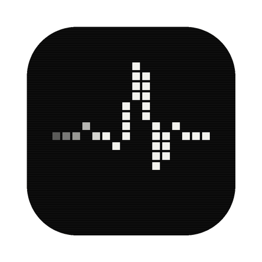
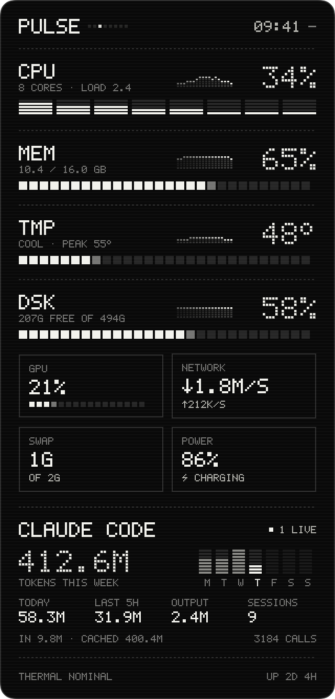
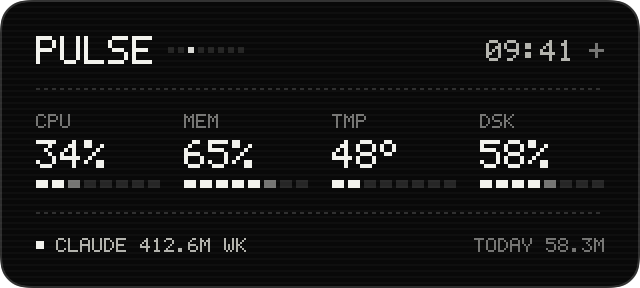
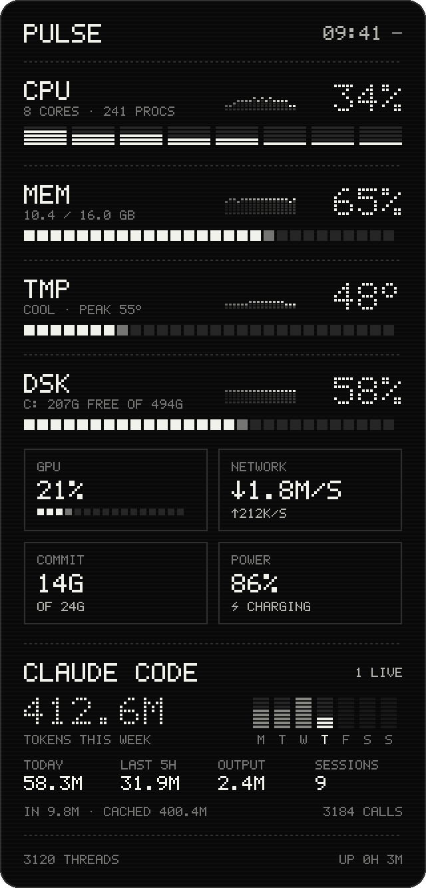

<p align="center">
  
</p>

<h1 align="center">Pulse</h1>

<p align="center">
  A tiny monochrome pixel widget that shows your machine's vital signs —<br>
  and how many Claude Code tokens you've spent this week.<br>
  <b>macOS</b> · <b>Windows</b>
</p>

<p align="center">
  
  &nbsp;&nbsp;
  
</p>

---

## What it shows

| | |
|---|---|
| **CPU** | total load, a pixel meter per core, 30‑second trend |
| **Memory** | used / total (Activity Monitor's "Memory Used" on macOS) |
| **Temperature** | SoC sensors on Apple Silicon · ACPI thermal zone on Windows |
| **Disk** | free space on the system drive |
| **GPU** | utilisation (IOAccelerator on macOS, GPU Engine counters on Windows) |
| **Network** | download / upload per second |
| **Swap / Commit** | swap on macOS, commit charge on Windows |
| **Power** | battery %, charging state |
| **Claude Code** | tokens this week (Mon–Sun chart), today, last 5 h, output, sessions, live sessions |

Everything is drawn with a hand-made 5×7 pixel font — no system fonts, no images.
Subtle loops (a header scanner, a breathing *live* pixel, a slow CRT sweep) run on the
compositor, so the widget idles at a few percent CPU. They switch off when the OS asks
for reduced motion.

<details>
<summary>Windows screenshot</summary>
<p align="center"></p>
</details>

## Install

Grab the latest build from **[Releases](../../releases)**.

**Windows 10 / 11** — unzip `Pulse-windows-x64.zip` and run `Pulse.exe` (self-contained, no .NET install needed).
SmartScreen may warn because the build isn't code-signed: *More info → Run anyway*.

**macOS 13+** — unzip `Pulse-macos-universal.zip`, move `Pulse.app` to Applications. The app is ad-hoc signed,
so the first time run:

```sh
xattr -dr com.apple.quarantine /Applications/Pulse.app
```

## Use

- **Drag** anywhere to move it — the position is remembered.
- **Click the header** to step through three sizes: **Full** (everything), **Compact** (CPU, memory, temperature, disk) and **Mini** (one quiet line, no motion).
- **Right-click** for *Size*, *Always on Top*, *Launch at Login*, Activity Monitor / Task Manager, *Quit*.

## Claude Code usage

Pulse reads the session transcripts Claude Code keeps on disk
(`~/.claude/projects` — or `$CLAUDE_CONFIG_DIR/projects` if you set it) and adds up the `usage`
block of every API response since Monday 00:00. Responses are de-duplicated by message and request id,
and each pass reads only the bytes appended since the last one, so after the first scan it's nearly free.

- **Tokens this week** = input + output + cache writes + cache reads.
- **Live** = sessions whose transcript changed in the last 5 minutes.
- It counts Claude Code only (not the Claude desktop or web apps) and can't see plan limits.
- Nothing leaves your machine — Pulse makes no network requests.

## Website

`site/` is the marketing page: plain static files, no build. Serve the folder with any web server;
`deploy/nginx.conf` is a ready-made nginx server block for a VPS.

```sh
python3 -m http.server -d site 8080   # preview locally
```

## Build from source

**macOS** (Xcode command line tools):

```sh
./macos/build.sh                                   # → ~/Applications/Pulse.app
UNIVERSAL=1 APP=dist/Pulse.app ./macos/build.sh    # Apple Silicon + Intel
```

**Windows** (.NET 8 SDK):

```sh
dotnet publish windows/Pulse/Pulse.csproj -c Release -r win-x64 --self-contained -p:PublishSingleFile=true -o out
```

Both apps can render themselves to a PNG without opening a window, which is handy for screenshots and CI:

```sh
Pulse --snapshot out.png [--compact | --mini] [--demo]   # --demo uses fake numbers
```

## Project layout

```
macos/     Pulse.swift — the whole macOS app (SwiftUI + AppKit), build.sh, icon
windows/   Pulse/ — WPF app: pixel renderer, probes, Claude usage scanner
site/      marketing page — static HTML/CSS/JS, no build step (see deploy/)
assets/    icon
docs/      screenshots
```

Temperature on Windows comes from ACPI thermal zones because Windows has no public per-core CPU
sensor API; some desktops report a fixed value or none at all, in which case Pulse shows `N/A`.

## License

MIT
