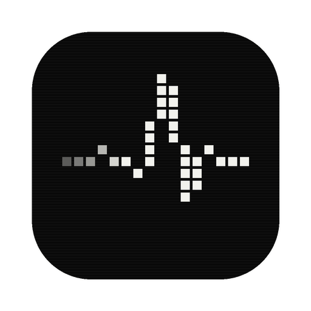
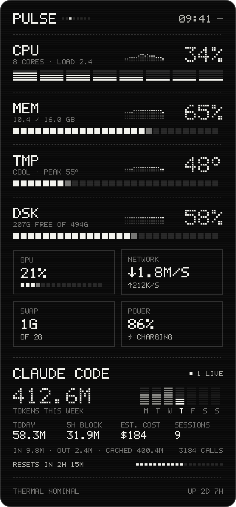
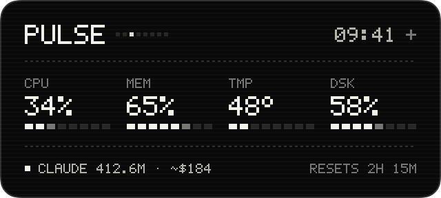
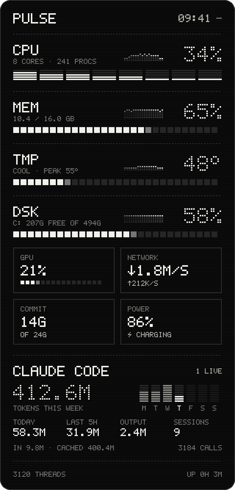
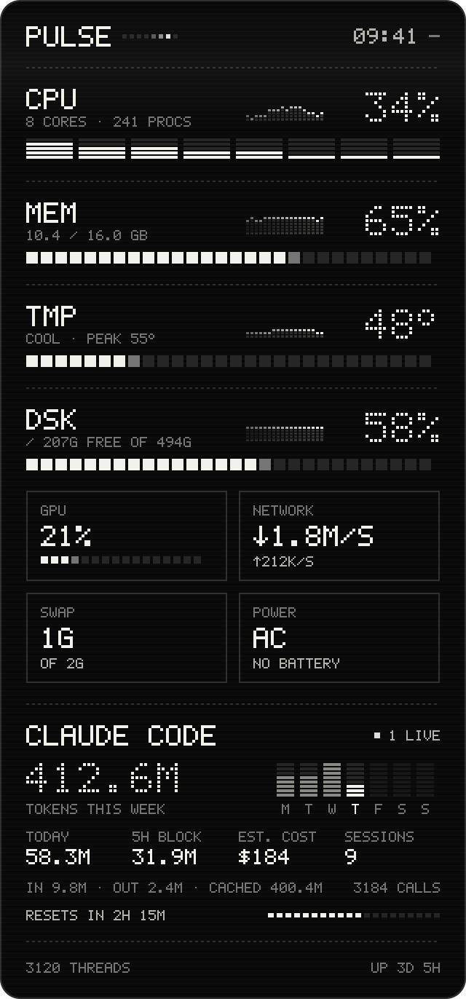

<p align="center">
  
</p>

<h1 align="center">Pulse</h1>

<p align="center">
  A tiny monochrome pixel widget that shows your machine's vital signs —<br>
  and how many Claude Code tokens you've spent this week.<br>
  <b>macOS</b> · <b>Windows</b> · <b>Linux</b> (incl. NVIDIA DGX Spark)
</p>

<p align="center">
  
  &nbsp;&nbsp;
  
</p>

---

## What it shows

| | |
|---|---|
| **CPU** | total load, a pixel meter per core, 30‑second trend · click for the top 3 processes |
| **Memory** | used / total (Activity Monitor's "Memory Used" on macOS, `MemTotal − MemAvailable` on Linux) · click for the top 3 processes |
| **Temperature** | SoC sensors on Apple Silicon · ACPI thermal zone on Windows · thermal zones / hwmon on Linux |
| **Disk** | free space on the system drive |
| **GPU** | utilisation (IOAccelerator on macOS, GPU Engine counters on Windows, `nvidia-smi` on Linux) |
| **Network** | download / upload per second |
| **Swap / Commit** | swap on macOS and Linux, commit charge on Windows |
| **Power** | battery %, charging state |
| **Claude Code** | signed-in account and plan (follows `/login`), tokens this week (Mon–Sun chart), today, current 5‑hour block with a reset countdown, estimated cost, sessions, live sessions |

Everything is drawn with a hand-made 5×7 pixel font — no system fonts, no images.
Subtle loops (a header scanner, a breathing *live* pixel, a slow CRT sweep) run on the
compositor, so the widget idles at a few percent CPU. They switch off when the OS asks
for reduced motion.

<details>
<summary>Windows screenshot</summary>
<p align="center"></p>
</details>

<details>
<summary>Linux screenshot (demo numbers)</summary>
<p align="center"></p>
</details>

## Install

Grab the latest build from **[Releases](../../releases)**.

**Windows 10 / 11** — unzip `Pulse-windows-x64.zip` and run `Pulse.exe` (self-contained, no .NET install needed).
SmartScreen may warn because the build isn't code-signed: *More info → Run anyway*.

**macOS 13+** — unzip `Pulse-macos-universal.zip`, move `Pulse.app` to Applications. The app is ad-hoc signed,
so the first time run:

```sh
xattr -dr com.apple.quarantine /Applications/Pulse.app
```

**Linux** (Ubuntu / DGX OS, aarch64 or x86-64) — unpack `Pulse-linux.tar.gz` and run the installer. It's pure Python, nothing to compile:

```sh
tar xzf Pulse-linux.tar.gz && cd pulse-linux && ./install.sh
pulse            # or open Pulse from the app grid
```

It needs GTK 3 bindings, which a desktop DGX OS / Ubuntu already has
(`sudo apt install python3-gi python3-gi-cairo gir1.2-gtk-3.0` otherwise). Under GNOME on Wayland Pulse runs
through XWayland so that *remember position*, *Always on Top* and *all workspaces* work; set
`PULSE_NATIVE_WAYLAND=1` to opt out. On a DGX Spark the GPU row comes from `nvidia-smi`, memory is the
unified pool, and the Power tile reads `AC · NO BATTERY`. `./install.sh --uninstall` removes it.

## Use

- **Drag** anywhere to move it. Dropped near a screen edge, corner or the centre line, it glides onto it.
- **Views** — like a phone widget, pick the shape that fits the spot:
  **Full** (everything), **Landscape** (system on the left, Claude on the right — for the top of a wide screen),
  **Claude** (account, limits, this week and where the tokens went), **Compact** (CPU, memory, temperature, disk)
  and **Mini** (one quiet line, no motion). *Right-click → View → Choose View…* opens a gallery of live previews;
  clicking the header steps through them. Each view remembers its own position, per monitor arrangement, so
  switching views can move the widget to where that view lives.
- **Resize** by dragging the bottom corner (the one away from the screen edge it's pinned to), with
  **Ctrl + scroll**, or from *Scale* (100–200%). Size and view changes morph smoothly; with reduced motion they're instant.
- **Hover** any number for its exact value.
- **Click CPU or MEM** (Full) to list the three processes using the most; **click the Claude section** (Full,
  Landscape) for tokens by model, project and account. Click again to close.
- **Right-click** for *View*, *Scale*, *Opacity*, *Always on Top*, *Click-through*, *Alerts*, *Plan Limits*,
  *Launch at Login*, Activity Monitor / Task Manager / System Monitor, *Hide to Tray*, *Quit*.
- **Click-through** lets clicks pass to whatever is underneath. Turn it off with **Ctrl+Alt+P** (⌃⌥P on macOS) or the tray icon.
- **Alerts** notify you when the CPU runs hot or memory is nearly full for 30 seconds, when your 5-hour block
  resets, and when a plan limit passes 80% and 95%.

## Claude Code usage

Pulse reads the session transcripts Claude Code keeps on disk
(`~/.claude/projects` — or `$CLAUDE_CONFIG_DIR/projects` if you set it) and adds up the `usage`
block of every API response since Monday 00:00. Responses are de-duplicated by message and request id,
and each pass reads only the bytes appended since the last one, so after the first scan it's nearly free.

- **Tokens this week** = input + output + cache writes + cache reads.
- **5H block** = tokens since the current five-hour block opened. A block opens at the hour of your first
  message after the previous one ran out; the countdown shows when it resets.
- **Est. cost** = each response priced by its model at Anthropic's API list rates (input, output, cache write,
  cache read). On a subscription you don't pay per token, so treat it as value, not a bill. The rates are one
  table (`ClaudeUsage.prices` in `macos/Pulse.swift`, `Prices` in `windows/Pulse/ClaudeUsage.cs`, `PRICES` in `linux/pulse/claude.py`); unknown models count as $0.
- **Live** = sessions whose transcript changed in the last 5 minutes.
- **Account** = the claude.ai account Claude Code is signed in with, read from `~/.claude.json`, so it follows
  `/login`. Transcripts don't record the account, so *by account* credits tokens to whoever was signed in when
  Pulse saw them; the first account Pulse ever sees also owns the history before it.
- **By project** uses the last folder of each session's working directory.
- It counts Claude Code only (not the Claude desktop or web apps).

**Plan limits** are the one thing that touches the network. Pulse asks Anthropic for the same numbers
Claude Code's `/usage` shows (`api.anthropic.com/api/oauth/usage`), every five minutes, with the sign-in token
Claude Code already keeps (`~/.claude/.credentials.json`; the Keychain on macOS). It only reads — it never
refreshes or stores the token — and nothing else is sent. Turn it off with *Right-click → Plan Limits (online)*;
everything else stays on your machine.

## Website

`site/` is the marketing page: plain static files, no build. Serve the folder with any web server;
`deploy/nginx.conf` is a ready-made nginx server block for a VPS.

```sh
python3 -m http.server -d site 8080   # preview locally
```

## Build from source

**macOS** (Xcode command line tools):

```sh
./macos/build.sh                                   # → ~/Applications/Pulse.app
UNIVERSAL=1 APP=dist/Pulse.app ./macos/build.sh    # Apple Silicon + Intel
```

**Windows** (.NET 8 SDK):

```sh
dotnet publish windows/Pulse/Pulse.csproj -c Release -r win-x64 --self-contained -p:PublishSingleFile=true -o out
```

**Linux** (Python 3, PyGObject; the renderer needs only `pycairo`):

```sh
cd linux && python3 -m pulse                      # run from source
python3 -m unittest discover -s linux/tests       # from the repo root
```

All three apps can render themselves to a PNG without opening a window, which is handy for screenshots and CI:

```sh
Pulse --snapshot out.png [--compact | --mini] [--demo]   # --demo uses fake numbers
python3 -m pulse --snapshot out.png ...                  # Linux — needs no display or GTK
```

## Project layout

```
macos/     Pulse.swift — the whole macOS app (SwiftUI + AppKit), build.sh, icon
windows/   Pulse/ — WPF app: pixel renderer, probes, Claude usage scanner
linux/     pulse/ — Python + GTK 3 + Cairo app (same structure), install.sh, tests/
site/      marketing page — static HTML/CSS/JS, no build step (see deploy/)
assets/    icon
docs/      screenshots
```

Temperature on Windows comes from ACPI thermal zones because Windows has no public per-core CPU
sensor API; some desktops report a fixed value or none at all, in which case Pulse shows `N/A`.

## License

MIT
